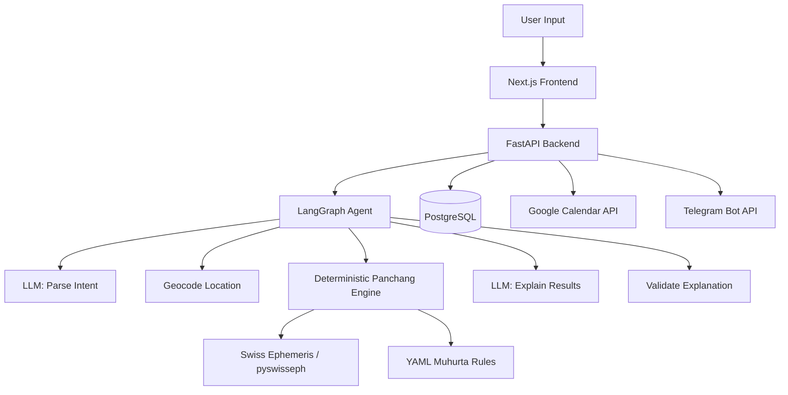
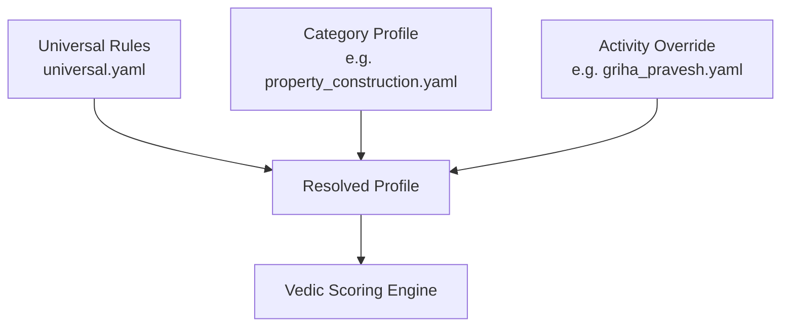

# 🪔 Vedic Muhurta Planner

[](https://muhurta-mauve.vercel.app/)
[](https://t.me/VedicMuhurtaBot)
[](https://muhurta.onrender.com/docs)

> **Auspicious timing, grounded in computation.** Describe your event in plain English, and Muhurta Planner finds the best time slots using a deterministic Vedic Panchang engine — the LLM only parses your request and explains the results.

### 🌐 Live Deployments
* **Live Web Application:** [https://muhurta-mauve.vercel.app/](https://muhurta-mauve.vercel.app/)
* **Telegram Bot Assistant:** [@VedicMuhurtaBot](https://t.me/VedicMuhurtaBot)
* **Interactive API Documentation:** [https://muhurta.onrender.com/docs](https://muhurta.onrender.com/docs)

## Architecture



## Key Design Decision

**Deterministic Engine + LLM for Parsing/Explaining Only**

The Panchang engine (`services/panchang.py`) computes all astronomical values — tithi, nakshatra, yoga, karana, sunrise/sunset, Rahu Kalam, and Choghadiya — using the Swiss Ephemeris with Lahiri ayanamsa. These calculations are **pure functions** with no LLM involvement.

The LLM has exactly two roles:
1. **Classify & Parse** the user's natural language request into structured constraints (activity category, override, date range, time preferences, location)
2. **Explain** the pre-computed results in friendly language, using **only** the astronomical facts provided by the engine

A validation step ensures the LLM's explanation doesn't introduce any astrological facts not present in the engine's output. This guarantees zero hallucinations, reproducibility, and accuracy.

## How Rules Work

Muhurta Planner implements a layered, deterministic rule architecture:



1. **Nakshatra Classes (`nakshatra_classes.yaml`):** The 27 nakshatras are partitioned into classical temperaments: *dhruva* (fixed), *chara* (movable), *kshipra* (swift), *mridu* (tender), *ugra* (fierce), *tikshna* (sharp/harsh), and *mishra* (mixed).
2. **Universal Rules (`universal.yaml`):** Applied to every request without exception. Filters out Rahu Kalam, inauspicious Choghadiyas (Udveg, Kaal, Rog), Amavasya (tithi 30), and harsh *tikshna* nakshatras.
3. **Category Profiles (`categories/*.yaml`):** 8 high-level categories covering everyday life:
   - `new_beginnings` (jobs, ventures, courses)
   - `property_construction` (real estate, rentals, building)
   - `vehicle_travel` (trips, vehicle delivery)
   - `money_business` (contracts, loans, investments, shop openings)
   - `education_learning` (exams, admissions, learning)
   - `relationships_family` (gatherings, engagements, anniversaries)
   - `purchases` (gold, appliances, valuables)
   - `general` (fallback profile for unmatched activities)
4. **Specific Overrides (`overrides/*.yaml`):** Fine-grained profiles extending categories (e.g. `griha_pravesh`, `marriage`, `naming_ceremony`, `vehicle_purchase`). Overrides can define custom hard-avoids and advisory notes (such as mandatory Pandit consultation).
5. **Merge Resolution:**
   - `hard_avoid`: Union across Universal, Category, and Override.
   - `soft_avoid` and `preferred`: Point values summed across layers.
   - `weights`: Later layers override earlier layers.
   - `advisory`: Inherited from the override.

### Confidence Routing & Clarification Flow
- **High confidence ($\ge 0.75$):** Immediately routed to the matching category or override engine.
- **Medium confidence ($0.40 \le c < 0.75$):** Returns `status: "needs_clarification"` with a clarifying question and category options for the user to select.
- **Low confidence ($< 0.40$):** Handled with `general` fallback profile using universal rules, with an explicit disclosure notice.

## Quick Start (3 commands)

```bash
# 1. Copy and configure environment
cp .env.example .env

# 2. Start all services
docker-compose up --build

# 3. Open the app
open http://localhost:3000
```

The app runs fully with `LLM_PROVIDER=mock` — no API keys needed for local development.

## Switching to Real Credentials

1. Set `LLM_PROVIDER=openai` or `LLM_PROVIDER=anthropic` in `.env`
2. Add the corresponding API key (`OPENAI_API_KEY` or `ANTHROPIC_API_KEY`)
3. For Google Calendar: create OAuth credentials and set `GOOGLE_CLIENT_ID` and `GOOGLE_CLIENT_SECRET`
4. For Telegram reminders: create a bot via @BotFather and set `TELEGRAM_BOT_TOKEN`
5. Restart: `docker-compose up --build`

## Deployment

1. Set all production environment variables
2. Use a managed PostgreSQL instance and update `DATABASE_URL`
3. Build and deploy the backend and frontend containers
4. Set up a cron job or AWS EventBridge schedule to call `POST /api/v1/internal/run-reminders` every minute with the `INTERNAL_API_KEY`

## Limitations

- **Rules reflect one tradition and are illustrative.** Every rule YAML begins with `# Illustrative rules for a single tradition (Drik/Lahiri). Verify against a source before real use.` Classical muhurta texts differ across regions and schools.
- **Complex rites require individual Pandit review.** Overrides such as `marriage` and `griha_pravesh` carry explicit advisory notes because birth chart matching (Kundali milan), Ashtakavarga, gotra considerations, and family customs are not evaluated by this app.
- **Panchang values are verified only against fixture dates.** The test fixtures cover specific reference dates; edge cases (e.g., very high latitudes, polar regions) may not be handled.
- **The LLM explanation is validated but astrological interpretation is not objectively verifiable.** The system ensures the explanation only references facts from the engine, but the "auspiciousness" interpretation is tradition-dependent.

## Assumptions

- Lahiri ayanamsa is used throughout (the most common in Indian astrology).
- Location geocoding uses the Open-Meteo API (no API key required).
- Time slots are 30 minutes each.
- A minimum 2-hour gap is enforced between the top 3 returned slots.
- Relative dates in user input (e.g., "next week") are resolved against the current date in the user's timezone.
- The dev-login endpoint is only available when `ENV=dev`.
